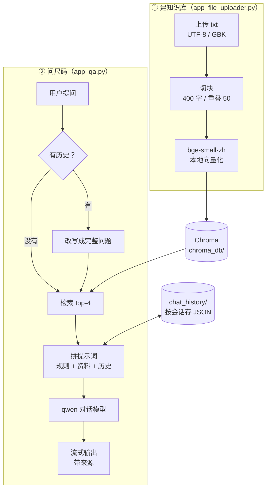
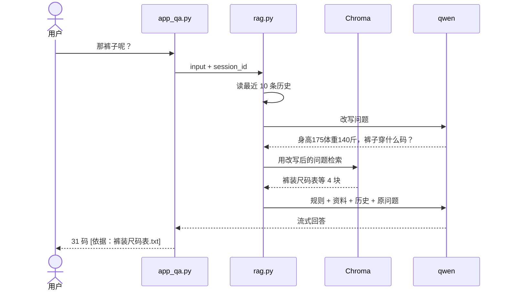
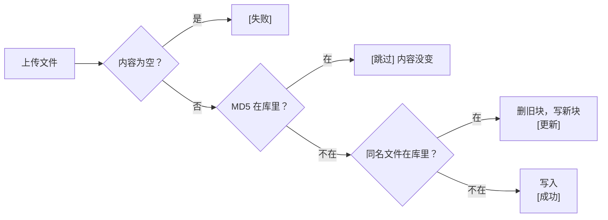

# 智能衣服尺码助手

中文 | [English](./README.en.md)

这个小助手把网购时候需要考虑的尺码表、版型说明做成知识库，用户报上身高体重和想买的品类，助手去查对应的尺码表，给出推荐尺码，并告诉你依据是哪张表。


## 先看效果

```text
我：身高175，体重140斤，T恤穿什么码？
助手：建议 L 码。身高175正好在 L 和 XL 的交界，体重140斤落在 L 码（130-145斤），
      尺码表说身高体重不在同一码时优先按体重选……
      [依据：男装T恤衬衫尺码表.txt]

我：那裤子呢？
助手：按身高175、体重140斤，男装裤子建议 31 码（腰围81cm）……
      [依据：裤装尺码表.txt]
```

第二句只说了"那裤子呢？"，助手会自己带上上一轮的身高体重去查裤装尺码表，不用重复说一遍。

## 和普通 RAG Demo 不一样的地方

| 做了什么 | 为什么要做 |
|---|---|
| 追问时先改写问题再检索 | 直接拿"那裤子呢？"去搜，向量库里根本搜不到有用的东西 |
| 提示词里定了 5 条规则 | 不编造尺码、缺身高体重先追问、夹在两码之间给两个选项、注明来源、回答简洁 |
| 向量模型用本地 bge-small-zh-v1.5 | 入库和检索不花 API 费用，也不受 Key 权限限制 |
| MD5 指纹存进向量库 metadata | 库和指纹永远同步，删库之后不会出现"内容已存在"的假提示 |
| 同名文件内容变了就替换 | 改了尺码表重新上传，旧数据会被删掉，不会新旧混着被检索到 |
| 每个浏览器一个会话 id | 分享给别人用时，各自的身高体重不会串 |
| 只把最近 10 条对话给模型 | 聊久了提示词不会越来越长 |
| 切块 400 字，切分符去掉 `.` | 一块正好装下一张表，也不会把 72.5kg 切成两半 |

## 整体流程



## 一次追问是怎么走的



第一轮没有历史，会跳过改写，省一次模型调用。

## 上传一个文件时会发生什么



## 知识库

`参考资料/` 里放了 6 份示例数据（不代表任何真实品牌），换成自己店铺的表就能用：

| 文件 | 内容 |
|---|---|
| 男装T恤衬衫尺码表.txt | S~3XL 对应身高、体重、胸围、衣长、肩宽 |
| 女装上衣连衣裙尺码表.txt | 女装上衣和连衣裙的尺码对照 |
| 外套尺码表.txt | 外套尺码，考虑内搭厚度 |
| 裤装尺码表.txt | 腰围、臀围、裤长对照 |
| 版型与选码建议.txt | 修身 / 常规 / 宽松的区别，两码之间怎么选 |
| 退换货与常见问题.txt | 退换货政策和售后问题 |

## 跑起来

**1. 装依赖**

```bash
git clone https://github.com/Raylxxx/rag-size-assistant.git
cd rag-size-assistant

conda create -n rag python=3.11
conda activate rag
pip install -r requirements.txt
```

**2. 配 Key**

对话模型走阿里云百炼。Key 放在环境变量 `DASHSCOPE_API_KEY` 里，代码里不写 Key。

```bash
export DASHSCOPE_API_KEY="你的 Key"      # macOS / Linux，长期用就写进 ~/.zshrc
set DASHSCOPE_API_KEY=你的 Key           # Windows CMD
```

我用的是百炼 Token Plan 个人版（Key 以 `sk-sp-` 开头），它只能走专用的 OpenAI 兼容地址，所以项目里用的是 `ChatOpenAI` + `chat_base_url`，没用 `ChatTongyi`。用普通 DashScope Key 的话，把 `config_data.py` 里的 `chat_base_url` 换成对应地址即可。

**3. 启动**

```bash
streamlit run app_file_uploader.py      # 上传页，先把 参考资料/ 里的 txt 传上去
streamlit run app_qa.py                 # 问答页，另开一个终端
```

第一次启动会下载向量模型（约 100MB，默认走 hf-mirror.com 镜像），之后用本地缓存。

**4. 分享给别人（可选）**

我是用 cpolar 做内网穿透，把问答页的端口映射出去。这时启动要关掉跨域检查：

```bash
streamlit run app_qa.py --server.enableCORS false --server.enableXsrfProtection false
```

## 配置

都在 `config_data.py`，常改的几个：

| 配置项 | 默认值 | 说明 |
|---|---|---|
| `chunk_size` / `chunk_overlap` | 400 / 50 | 一张尺码表大约 200~400 字 |
| `retriever_top_k` | 4 | 每次检索几块 |
| `score_threshold` | None | 相关度阈值，调好后可设 0.3 左右 |
| `max_history_messages` | 10 | 给模型看的历史条数（一问一答算 2 条） |
| `embedding_model_name` | BAAI/bge-small-zh-v1.5 | 换模型后要删掉 `chroma_db/` 重新上传 |
| `embedding_device` | cpu | 有 N 卡可改 cuda |
| `chat_model_name` | qwen3.8-max | 对话模型 |

`.streamlit/config.toml` 里关掉了文件监视（不然会刷出一堆无害的 torchvision 报错），改完代码要手动重启。

## 目录结构

```text
rag-size-assistant/
├── app_file_uploader.py    # 上传页
├── app_qa.py               # 问答页
├── rag.py                  # RAG 链：改写 → 检索 → 回答
├── knowledge_base.py       # 切块、入库、去重、替换
├── vector_stores.py        # 向量模型 + 检索器
├── file_history_store.py   # 对话记录
├── config_data.py          # 配置
├── requirements.txt
├── .streamlit/config.toml  # 关闭文件监视
├── 参考资料/               # 示例知识库
├── README.md / README.en.md
└── LICENSE
```

`chroma_db/` 和 `chat_history/` 是运行后自动生成的，没有放进仓库。

## License

[MIT](./LICENSE) © Raylxxx
